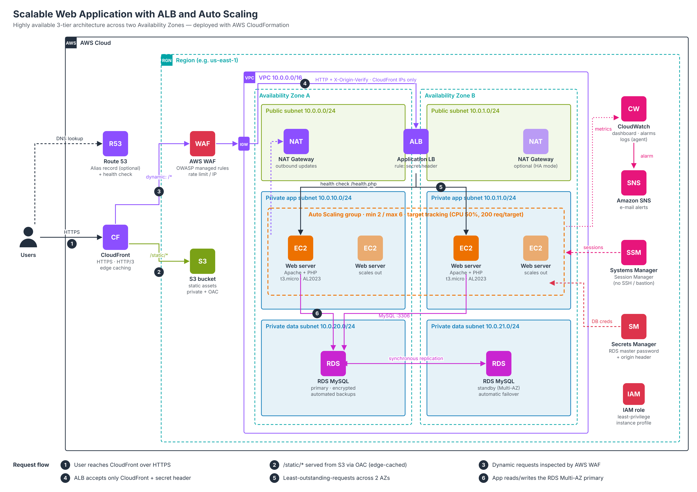

# Scalable Web Application with ALB and Auto Scaling

AWS Solutions Architect – Associate graduation project (Project 1).

A highly available web application on AWS, built with the AWS Management Console in **eu-north-1 (Stockholm)**.

## Architecture

**Request flow:** User → CloudFront (HTTPS) → AWS WAF → Application Load Balancer → EC2 (Auto Scaling, 2 AZs) → RDS MySQL

## AWS Services Used

| Service | Purpose |
|---|---|
| VPC | 6 subnets in 2 AZs (public, private app, private database), Internet Gateway, NAT Gateway |
| Security Groups | ALB ← Internet, EC2 ← ALB only, RDS ← EC2 only. No SSH |
| EC2 + Launch Template | Web servers (Amazon Linux 2023, Apache + PHP) |
| Auto Scaling | Min 2 / Max 4, scales on CPU 50% |
| Application Load Balancer | Distributes traffic across 2 AZs, health check `/health.php` |
| AWS WAF | OWASP rules, SQL injection, bad inputs, IP reputation, rate limit |
| CloudFront | HTTPS and edge delivery in front of the ALB |
| RDS MySQL | Database in isolated private subnets, encrypted |
| Secrets Manager | Stores the database password |
| IAM Role | Least-privilege permissions for EC2 |
| Systems Manager | Session Manager access instead of SSH |
| CloudWatch + SNS | Alarms and e-mail alerts |

## Steps

1. Created the VPC and subnets
2. Created the security groups
3. Created the RDS MySQL database
4. Created the IAM role for EC2
5. Created the launch template with a user data script ([`scripts/user-data.sh`](scripts/user-data.sh))
6. Created the target group and the Application Load Balancer
7. Created the Auto Scaling group
8. Added AWS WAF to the ALB
9. Added CloudFront in front of the ALB
10. Set up CloudWatch alarms and SNS e-mail notifications
11. Deleted all resources after finishing to avoid charges

## Problem I Faced

The EC2 instances were **unhealthy** because I forgot to put the real secret ARN in the user data script. I found the error using **Session Manager** and the cloud-init log, fixed the launch template, and the Auto Scaling group replaced the instances automatically.

## Notes

- The account is on the AWS Free plan, so RDS was **Single-AZ**. In production I would use **Multi-AZ**.

## Screenshots

All screenshots are in the Word file

## Author

**Abdelrahman Al Sheyab**
